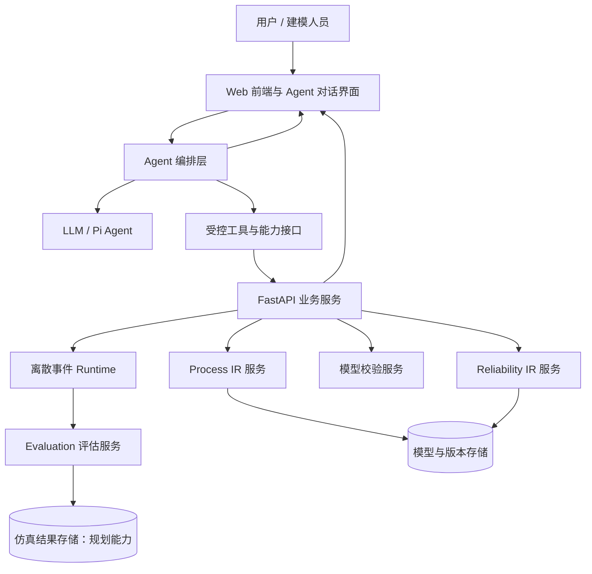

# Reliability Flow Agent 系统总体架构

## 1. 架构设计目标

系统采用“Agent 交互与需求理解 + 结构化 IR + 确定性业务服务 + 离散事件 Runtime + Evaluation”的分层架构。

核心原则：
- Agent 负责理解、组织和解释，不直接替代确定性执行组件。
- Process IR 与 Reliability IR 是需求理解结果进入后端业务系统的结构化契约。
- 校验、仿真和评估由后端服务执行并返回真实结果。
- 模型保存和仿真启动属于需要用户确认的操作。
- 各层通过明确 API 和数据结构解耦。

## 2. 逻辑架构

图中“仿真结果存储”表示目标架构中的规划能力，不代表当前已经完成持久化。

## 3. 分层职责

### 3.1 用户交互层

由 Web 前端提供需求输入、Agent 对话、模型展示与编辑、校验反馈、仿真配置和结果可视化。

当前已有 React Flow 建模工作台、Inspector 及仿真评估相关界面。AgentPanel 已有基础交互，但目前主要通过前端本地规则/正则命令解析执行，不应视为完整 Agent 对话系统。

### 3.2 Agent 编排层

目标上由后端启动并管理受控的 Pi RPC 子进程，负责：
- 组织多轮需求澄清；
- 调用项目能力查询和模型校验工具；
- 生成 Process IR、Reliability IR 草稿；
- 将工具执行结果转换为面向用户的解释；
- 维护任务状态和用户确认节点。

Agent 不应绕过业务 API 直接修改数据库或直接启动未获批准的仿真。工具权限应采用白名单，默认不向 Agent 暴露任意 Shell、PowerShell、文件写入或编辑能力。

### 3.3 IR 模型层

**Process IR** 描述业务流程、活动节点、连接关系、条件和循环等信息。

**Reliability IR** 描述设备或对象的可靠性属性，并与明确的 Process 版本/内容哈希绑定。

两类 IR 应具备稳定 Schema、版本管理、校验规则和可追溯标识。Agent 输出应先作为草稿，经校验和用户确认后再进入正式保存流程。

### 3.4 业务服务层

FastAPI 提供统一业务入口，职责包括：
- Process IR 创建、读取、校验和版本管理；
- Reliability IR 创建、读取、校验和版本管理；
- 仿真配置校验与运行请求；
- Evaluation 计算和结果组织；
- 后续的 Session、Task、审批和结果查询接口。

当前已有 Process IR、Reliability IR、Runtime、Evaluation 相关 API 基础。完整 Agent API 和任务生命周期管理尚未完成。

### 3.5 仿真执行层

Python 离散事件 Runtime 负责按事件时间顺序推进仿真，维护实体状态、任务活动和故障/维修相关状态，并采集执行数据。

当前 Runtime 已具备事件队列、多实体执行和可复现随机流等基础能力。repair 与 daily 的详细规则必须由正式业务定义、实现和测试共同确定。

### 3.6 评估层

Evaluation 消费 Runtime 的真实输出，计算整体、节点和设备指标，执行目标判定并生成警告与解释信息。

Agent 只负责解释评估结果，不得自行编造数值或将推断值冒充运行结果。

### 3.7 存储层

当前已有模型版本化存储及内容哈希等基础。目标上还需要建立仿真运行记录、结果持久化、独立 result ID、任务历史及 Session 关联。上述缺失能力应作为后续开发任务，不应在现阶段描述为已完成。

## 4. 核心数据流

1. **需求输入**：用户提交文本或需求文件。
2. **信息抽取**：Agent 提取实体、活动、流程关系、资源、可靠性参数和运行约束。
3. **草稿生成**：Agent 生成 Process IR 与 Reliability IR 草稿，并标注来源、假设和待确认项。
4. **模型校验**：后端校验 IR 结构、引用和业务约束。
5. **用户确认**：用户确认模型内容及运行配置。
6. **模型保存**：通过正式业务 API 保存模型版本。
7. **仿真执行**：Runtime 根据模型和运行配置执行离散事件仿真。
8. **结果评估**：Evaluation 计算指标并形成解释。
9. **结果呈现**：前端展示运行状态、指标、警告和解释；后续完善持久化及历史查询。

## 5. Agent 与后端的交互约束

建议将 Agent 工具划分为只读、草稿生成、校验和需审批操作几类：

| 工具类型 | 示例 | 权限原则 |
|---|---|---|
| 只读查询 | 获取项目能力、读取模型 | 可按会话权限调用 |
| 草稿生成 | 生成 Process IR 草稿 | 不直接写入正式模型 |
| 校验 | 调用后端模型校验 API | 必须返回真实校验结果 |
| 保存 | 保存正式模型版本 | 必须经过用户明确确认 |
| 仿真 | 启动 Runtime | 必须经过用户明确确认 |
| 结果查询 | 查询运行状态和结果 | 只能读取真实运行记录 |

Pi RPC 集成建议由后端启动受控子进程，通过 JSONL 事件解析消息、工具开始/结束和 Agent settled 等事件，再通过 SSE 或 WebSocket 推送给前端。该方案属于目标实现设计，需通过实际集成测试确认。

## 6. 安全与可靠性要求

- 使用工具白名单和最小权限原则。
- 不向 Agent 暴露任意命令执行能力。
- 对用户输入、文件内容和工具返回内容均视为不可信数据。
- 对保存和仿真等有副作用的操作设置显式审批。
- 校验失败时阻止进入正式仿真。
- 记录模型版本、运行配置、随机种子和结果关联信息。
- 对超时、进程退出、工具失败和断连提供明确错误状态。

## 7. 部署与演进建议

建议分阶段推进：
1. 完善 Agent 后端服务和受控 Pi RPC 生命周期；
2. 建立 SSE 事件通道及前端真实 Agent 对话；
3. 完成 IR 草稿、校验和用户确认闭环；
4. 完成受控模型保存和仿真启动；
5. 完成结果持久化、查询和实验历史；
6. 完善 repair、daily 等领域规则及边界测试。

每阶段均应以 API 契约、自动化测试和端到端验证为验收依据。
